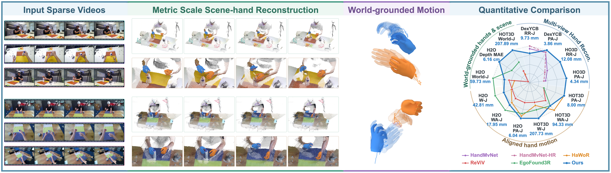
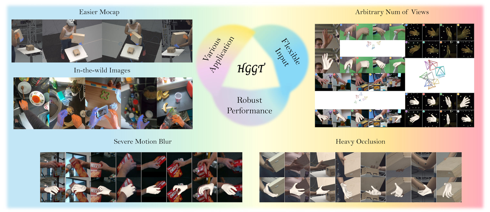

<h1 align="center">HGGT &amp; FReSH</h1>

> [!IMPORTANT]
> **HGGT is the local branch of [FReSH](https://lym29.github.io/FReSH/).**
> FReSH jointly reconstructs scene geometry, hand motion, and cameras from sparse, uncalibrated videos.

<p align="center">
  <a href="#fresh"><b>FReSH — Latest work</b></a> &nbsp;·&nbsp;
  <a href="#hggt">HGGT — Original work</a> &nbsp;·&nbsp;
  <a href="#code">HGGT code and usage</a>
</p>

<a id="fresh"></a>

## FReSH — Latest work

<h2 align="center">FReSH: Feed-Forward Joint Reconstruction of Scene-Hand from Uncalibrated Sparse Videos</h2>

<p align="center">
  <a href="https://lym29.github.io/">Yumeng Liu</a><sup>1</sup>,
  <a href="https://www.xxlong.site/">Xiao-Xiao Long</a><sup>2</sup>,
  <a href="https://people.mpi-inf.mpg.de/~mhaberma/">Marc Habermann</a><sup>3</sup>,
  <a href="https://github.com/TheVaticanCameos">Xuanze Yang</a><sup>1</sup>,
  <br>
  <a href="https://clinplayer.github.io/">Cheng Lin</a><sup>4</sup>,
  <a href="https://liuyuan-pal.github.io/">Yuan Liu</a><sup>5</sup>,
  <a href="https://yuexinma.me/">Yuexin Ma</a><sup>6</sup>,
  <a href="http://staff.ustc.edu.cn/~lgliu/">Ligang Liu</a><sup>1*</sup>
</p>

<p align="center">
  <sup>1</sup>USTC &nbsp;
  <sup>2</sup>Nanjing University &nbsp;
  <sup>3</sup>MPI-INF &nbsp;
  <sup>4</sup>MUST Macau &nbsp;
  <sup>5</sup>HKUST &nbsp;
  <sup>6</sup>ShanghaiTech &nbsp;
  <br>
  <sup>*</sup>Corresponding author
</p>

<p align="center">
  <a href="https://lym29.github.io/FReSH/"></a>
  <a href="https://lym29.github.io/FReSH/assets/FReSH-paper.pdf"></a>
  <a href="https://lym29.github.io/FReSH/assets/FReSH-supplementary.pdf"></a>
  <a href="https://lym29.github.io/FReSH/#video"></a>
</p>

<p align="center">
  <a href="https://lym29.github.io/FReSH/">
    
  </a>
</p>

<p align="center">
  <b>FReSH</b> turns sparse, uncalibrated videos into metric-scale scenes and world-grounded hand motion with a feed-forward model.
</p>

---

<a id="hggt"></a>

## HGGT — Original work

<h2 align="center">HGGT: Robust and Flexible 3D Hand Mesh Reconstruction from Uncalibrated Images</h2>

<p align="center">
  <a href="https://lym29.github.io/">Yumeng Liu</a><sup>1</sup>,
  <a href="https://www.xxlong.site/">Xiao-Xiao Long</a><sup>2</sup>,
  <a href="https://people.mpi-inf.mpg.de/~mhaberma/">Marc Habermann</a><sup>3</sup>,
  <a href="https://github.com/TheVaticanCameos">Xuanze Yang</a><sup>1</sup>,
  <a href="https://clinplayer.github.io/">Cheng Lin</a><sup>4</sup>,
  <br>
  <a href="https://liuyuan-pal.github.io/">Yuan Liu</a><sup>5</sup>,
  <a href="https://yuexinma.me/">Yuexin Ma</a><sup>6</sup>,
  <a href="http://staff.ustc.edu.cn/~lgliu/">Ligang Liu</a><sup>1*</sup>
</p>

<p align="center">
  <sup>1</sup>USTC &nbsp;
  <sup>2</sup>Nanjing University &nbsp;
  <sup>3</sup>MPI-INF &nbsp;
  <sup>4</sup>MUST Macau &nbsp;
  <sup>5</sup>HKUST &nbsp;
  <sup>6</sup>ShanghaiTech &nbsp;
  <br>
  <sup>*</sup>Corresponding author
</p>

<p align="center">
  <a href="https://arxiv.org/abs/2603.23997"></a>
  <a href="https://lym29.github.io/HGGT/"></a>
  <a href="https://huggingface.co/datasets/catmint123/HGGT-synthetic-data"></a>
  <a href="https://huggingface.co/catmint123/HGGT"></a>
  <a href="https://github.com/lym29/HGGT"></a>
</p>

<p align="center">
  
</p>

<p align="center">
  We introduce <b>H</b>and <b>G</b>eometry <b>G</b>rounding <b>T</b>ransformer (<b>HGGT</b>), a scalable and generalized solution for 3D hand mesh recovery. Our method unifies diverse data sources to achieve robust performance across varying camera viewpoints and environments.
</p>

---

<a id="code"></a>

## HGGT code and usage

The instructions below cover the HGGT implementation, pretrained models, and synthetic dataset.

### Table of Contents

- [⚙️ Installation](#⚙️-installation)
- [🚀 Demo (pre-cropped multi-view images)](#🚀-demo-pre-cropped-multi-view-images)
- [📊 Evaluation](#📊-evaluation)
- [🏋️ Training](#🏋️-training)
- [📁 Dataset](#📁-dataset)
- [🙏 Acknowledgements](#🙏-acknowledgements)

---

## TL;DR

We present the **first feed-forward framework** that jointly estimates 3D hand meshes and camera poses from **uncalibrated** multi-view images.

## TODO

- [x] Release synthetic dataset on Hugging Face
- [x] Release dataset generation pipeline code (due July 17)
- [x] Release pretrained model checkpoints
- [x] Release model inference code (due July 17)
- [x] Release evaluation scripts (due July 20)
- [x] Release fine-tuning code and configuration

---

## ⚙️ Installation

### Create the conda environment

```bash
conda create -n hggt python=3.10 -y
conda activate hggt

pip install -r requirements.txt
```

### MANO models (required for mesh overlay and evaluation)

Download MANO from the [MANO website](http://mano.is.tue.mpg.de/), unzip, and place the model files under:

```text
assets/mano_v1_2/models/MANO_RIGHT.pkl
```

Mesh overlays and multi-view image evaluation require MANO; loading the network and writing `mano_params` to `result.npz` does not.

### Pretrained weights

Default demo loading uses Hugging Face:

```text
https://huggingface.co/catmint123/HGGT
```

via `HGGT.from_pretrained("catmint123/HGGT")`. A local training checkpoint (`.pt` with a `model` state dict) can be passed with `--checkpoint`.

---

## 🚀 Demo (pre-cropped multi-view images)

This demo reads **already hand-cropped** multi-view images (one square crop per view), runs HGGT, and writes a mosaic / optional mesh overlays / `result.npz`.

Hand detection from full-frame images and video demos will be added in a follow-up release.

```bash
# Example: Arctic sample (multi-view)
python demo/demo_multiview_images.py \
  --image_folder examples/multiview/Arctic/sample_0000 \
  --output_dir outputs/demo_arctic_0000

# Optional: local checkpoint and MANO path
python demo/demo_multiview_images.py \
  --image_folder examples/multiview/HO3D/sample_0000 \
  --checkpoint /path/to/checkpoint.pt \
  --mano_model_path assets/mano_v1_2/models \
  --output_dir outputs/demo_ho3d_0000
```

Bundled examples live under [`examples/multiview/`](examples/multiview/) (2 samples from each of HO3D, DexYCB, Arctic, Interhand, Oakink, Freihand). Freihand examples are single-view.

Typical outputs:

- `input_mosaic.jpg` — input views side-by-side
- `overlay_mosaic.jpg` — solid mesh overlays for all views side-by-side (pyrender)
- `result.npz` — `mano_params`, cameras, and vertices when MANO is available

---

## 📊 Evaluation

Evaluate HGGT on multi-view WebDataset tars from standard hand datasets (HO3D, DexYCB, Arctic, Interhand, Oakink, Freihand).

Download the evaluation data from [JubSteven/POEM-v2](https://huggingface.co/datasets/JubSteven/POEM-v2/tree/main). Full setup, launchers (`run_eval_mv_image.sh`, `eval_mv_image.slurm`), and metric details are in [`eval/README.md`](eval/README.md).

---

## 🏋️ Training

Fine-tune HGGT with alternating single-view hand data and synthetic multi-view data. The release includes a configurable PyTorch training loop, a four-GPU recipe, and a generic Slurm launcher.

See [`training/README.md`](training/README.md) for data preparation, checkpoint initialization, training, and resume instructions. A compatible HGGT checkpoint is required to initialize fine-tuning.

```bash
# Inspect the default recipe without downloading data or model weights
python -m hggt.training.launch --config training/configs/finetune.yaml --check-config
```

---

## 📁 Dataset

### Download

Our synthetic dataset is available on Hugging Face:

<a href="https://huggingface.co/datasets/catmint123/HGGT-synthetic-data">
  
</a>

```bash
# Download via huggingface_hub
python -c "
from huggingface_hub import snapshot_download
snapshot_download(
    repo_id='catmint123/HGGT-synthetic-data',
    repo_type='dataset',
    local_dir='data/hggt_synthetic',
)
"
```

After downloading, extract the tar shards:

```bash
for shard in data/hggt_synthetic/data/{small,medium,large}/*.tar; do
  [ -f "$shard" ] || continue
  tar -xf "$shard" -C "$(dirname "$shard")"
done
```

Please refer to the [dataset page](https://huggingface.co/datasets/catmint123/HGGT-synthetic-data) for details on the dataset structure.

---

## 🙏 Acknowledgements

We would like to express our gratitude to the authors and contributors of the following projects:

- [VGGT](https://github.com/facebookresearch/vggt)
- [HaMeR](https://github.com/geopavlakos/hamer)
- [GraspXL](https://github.com/zdchan/GraspXL)
- [POEM-v2](https://github.com/JubSteven/POEM-v2/tree/release)

---

## Citation

If you find our work useful, please cite the corresponding paper:

### FReSH

```bibtex
@misc{liu2026fresh,
  title={FReSH: Feed-Forward Joint Reconstruction of Scene-Hand from Uncalibrated Sparse Videos},
  author={Liu, Yumeng and Long, Xiao-Xiao and Habermann, Marc and Yang, Xuanze and Lin, Cheng and Liu, Yuan and Ma, Yuexin and Liu, Ligang},
  year={2026},
  url={https://lym29.github.io/FReSH/}
}
```

### HGGT

```bibtex
@article{liu2026hggt,
  title={HGGT: Robust and Flexible 3D Hand Mesh Reconstruction from Uncalibrated Images},
  author={Liu, Yumeng and Long, Xiao-Xiao and Habermann, Marc and Yang, Xuanze and Lin, Cheng and Liu, Yuan and Ma, Yuexin and Liu, Ligang},
  journal={arXiv preprint arXiv:2603.23997},
  year={2026}
}
```
---

## License

This project is licensed under the [Apache License 2.0](LICENSE).

Third-party components retain their respective license terms; see [THIRD_PARTY_NOTICES.md](THIRD_PARTY_NOTICES.md).


